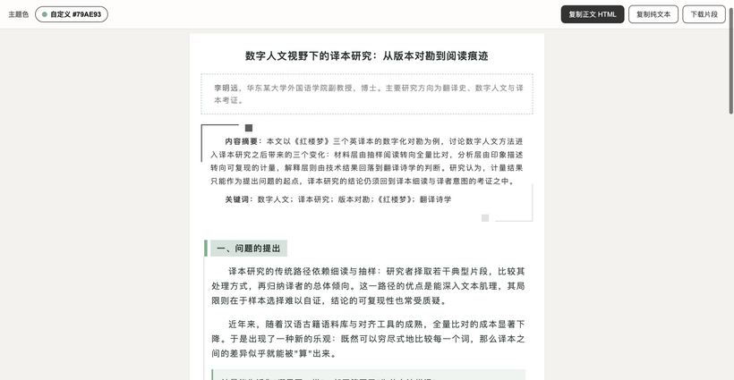
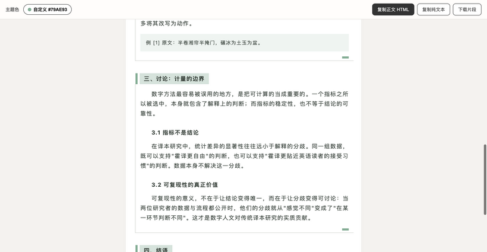

# 公众号学术排版 · wechat-academic-layout

把一篇学术论文排成「比较文学与翻译研究」风格的微信公众号正文——**大节左侧色条 + 浅色标签、正文开放方框、作者简介虚线卡、摘要角括号、例句浅底卡、END 收尾**，全部内联样式，粘进秀米或公众号后台不掉样式。

顺带把知网导出稿的一堆噪音（目录、英文摘要、参考文献、脚注「注」字、粘连标题）自动清掉，关键词自动断词。




## 特性

- **开箱即用**：`python3 scripts/build.py 论文.docx --theme sage --with-title -o out`，一条命令出三份文件。
- **直接吃四种输入**：`.docx`（标准库解包，不装 python-docx）、`.txt` / `.md`、公众号网页 `.html`、标准输入管道。
- **自动清洗**：删目录、英文摘要/Keywords、参考文献与注释、脚注「注」字，拆「标题+作者+单位+摘要」粘连段，切开与正文粘连的大节标题，期刊头改成文末「来源」行。
- **关键词自动断词**：知网把 `关键词:` 后的分隔符全剥掉了，脚本按「书名号／音译人名／正文语料 DP」三档猜边界。
- **六套主题 + 任意配色**：`peach` `ink` `sage` `clay` `sand` `mono`，或 `--accent "#79AE93"` 只给一个主题色，浅底/虚线/线条自动派生。
- **全内联、无依赖**：不写 `<style>`、不用 CSS 变量、不含 `class`，微信和秀米都不会剥样式；`scripts/check.py` 专门体检这一点。
- **本地预览页**：生成 `-preview.html`，可当场切换主题色、一键「复制正文 HTML」。

## 快速开始

需要 `python3`（macOS / Linux 自带即可，**不装任何第三方包**）。

**方式一：克隆后安装为 DSH 技能（推荐）**

```bash
git clone https://github.com/<你的用户名>/wechat-academic-layout.git
cd wechat-academic-layout
./install.sh          # 复制到 ~/.dsh/skills/wechat-academic-layout
```

装完新开一个会话，对 AI 说「用 wechat-academic-layout 把这篇文章排成公众号」即可。只想装给单个项目，就复制到该项目的 `.dsh/skills/` 下。

**方式二：不装技能，直接用脚本**

脚本是独立的，跟 DSH 无关：

```bash
python3 scripts/build.py 论文.docx --theme sage --with-title -o out
```

**方式三：Windows**

PowerShell 里复制目录即可：

```powershell
git clone https://github.com/<你的用户名>/wechat-academic-layout.git
Copy-Item -Recurse .\wechat-academic-layout "$HOME\.dsh\skills\wechat-academic-layout"
```

## 用法

```bash
# 1. 排版（.docx / .txt / .md / .html / - 标准输入 都行）
python3 scripts/build.py 论文.docx --theme sage --accent "#79AE93" --with-title -o out

# 2. 本地预览，点「复制正文 HTML」
open out/*-preview.html

# 3. 粘到秀米编辑器或公众号后台草稿箱
```

输出三份：

| 文件 | 用途 |
| --- | --- |
| `<标题>.html` | **正文片段**（全内联样式），粘公众号/秀米用 |
| `<标题>-preview.html` | 本地预览页：切换主题色、一键复制 |
| `<标题>.md` | 归一化后的稿子，改完可重跑 |

常用参数：

| 参数 | 说明 |
| --- | --- |
| `--theme peach\|ink\|sage\|clay\|sand\|mono` | 主题（默认 peach） |
| `--accent "#79AE93"` | 只换主题色，浅底/虚线/线条自动重新派生 |
| `--ink "#2E3B33"` | 只换正文字色 |
| `--with-title` | 正文顶部也排标题（粘秀米时几乎都要） |
| `--no-clean` | 关掉自动清洗，原样排版 |
| `--keywords "a；b；c"` | 手动指定关键词，覆盖自动断词 |
| `--max-para 480` | 超长段落按字数自动断段（默认关） |
| `--no-merge` | 关闭硬换行合并（原文一行一段时用） |
| `-t "标题"` / `-o 目录` / `--list-themes` | 覆盖标题 / 输出目录 / 列主题 |

> 换色只在**生成时**完成。微信会剥离 CSS 变量，所以生成器把颜色算成具体 hex 写进每个 style。

## 稿子怎么写才被正确识别

不用手加标记，按这些写法自动识别：

| 写法 | 结果 |
| --- | --- |
| `内容摘要：` / `摘要：` 开头段 | 摘要角括号块 |
| `关键词：` / `基金：` / `作者简介：` | 同上，自动排在摘要之后 |
| `一、` / `1.` 开头的行、整行 `**加粗**` | 大节（色条 + 浅色标签） |
| `（一）` / `1.1` 开头的行 | 小节（同色加粗、2em 缩进） |
| `例 [1]：` / `原文：` / `译文：` / `杨译：` / `霍译：` | 例句卡（浅底，相邻行自动合并成一块） |
| `> 引文` | 引言块（浅底 + 主题色左条） |
| `- 条目` | 项目列表（悬挂缩进） |
| `---` | 细分隔饰线 |
| `` | 居中图片 + 灰色图注 |

## 自动清洗（默认开）

| 自动做什么 | 例子 |
| --- | --- |
| 抽标题、期刊信息改文末「来源」 | `标题 (期刊) 中国比较文学 2026 (04)` → 文末「来源：《中国比较文学》2026年第4期」 |
| 删目录整块 | `目录 一、… 二、… 参考文献 注释` 全删（条目留作标题字典） |
| 拆「标题+作者+单位+摘要」挤成的一段 | 摘要单独成行，作者单位另起一行（有作者简介时不重复） |
| 删英文标题 / Abstract / Keywords | 正文开始前的英文段整段删 |
| 拆粘连的大节标题 | `一、xxx 印共早年发起过…` → 标题行 + 正文行 |
| 删脚注标记「注」 | `农业无产阶级；注二是…` → `…；二是…`；「注释」「关注」「注定」保留 |
| 删参考文献 / 注释 / References 尾部 | 从该标题起到文末整块删掉 |
| 删网页 UI 噪声 | `研学工具`、`顶部`、`参考文献 引证文献 注释 笔记`、纯页码 |
| 自动断关键词 | `关键词:印度英语纳萨尔小说底层南方…` → `印度英语纳萨尔小说；底层南方；…` |

关键词断词规则：有分隔符直接用；`《书名》` 前切开；`·` 音译人名后 2 字处切开；剩下的块用 DP，候选词必须在本篇正文（含标题、摘要）里出现 ≥2 次，按「长度^2.5 × 频次^0.2」取总分最大。已知案例 6/7 完全正确，剩下的是「作者自造、正文里从没原样出现的长复合词」，用 `--keywords` 覆盖即可。

只清洗不排版、先看结果：

```bash
python3 scripts/clean.py 论文.txt cleaned.txt    # 打印统计 + 前 1200 字
```

## 目录结构

```text
wechat-academic-layout/
├── SKILL.md                     # 给 AI 读的技能说明（版式规格、规则、参数）
├── README.md
├── install.sh                   # 装到 ~/.dsh/skills/
├── scripts/
│   ├── build.py                 # 排版生成器，纯 python3 无依赖
│   ├── clean.py                 # 自动清洗 + 关键词断词
│   ├── docx2txt.py              # .docx → 一段一行的纯文本
│   └── check.py                 # 粘贴兼容性体检
├── references/design-spec.md    # 版式实测数据与组件规格
├── examples/demo.md             # 通用示例稿，可拿来试排
└── docs/                        # README 截图
```

## 交付前自检

```bash
python3 scripts/check.py out
# ✓ 通过（警告不影响粘贴）
```

检查有没有 `class=`、`<style>`、`var(--…)`、`@media`、外部 `url()` 这些微信会剥掉的东西。

## 常见问题

- **粘进去全是纯文本**：复制的是纯文本。用预览页的「复制正文 HTML」按钮。
- **颜色全丢**：粘的是整个 preview 页面而不是正文片段。
- **大节没变成标签**：标题行没被识别——把该行整行加粗 `**…**`，或改成 `一、…` 开头。
- **例句卡被拆成好几块**：原文例句之间有空行，删掉空行即可合并。
- **不该删的被删了**：加 `--no-clean` 重跑；或先用 `scripts/clean.py` 看统计再改规则。

## 许可

MIT，见 [LICENSE](LICENSE)。随便用、随便改，改好了欢迎提 PR。
